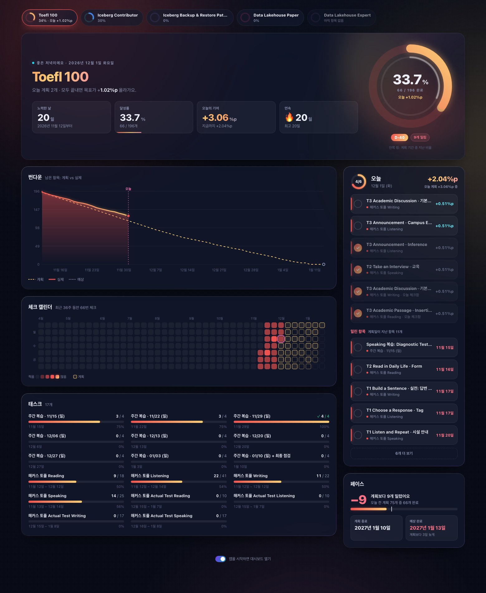
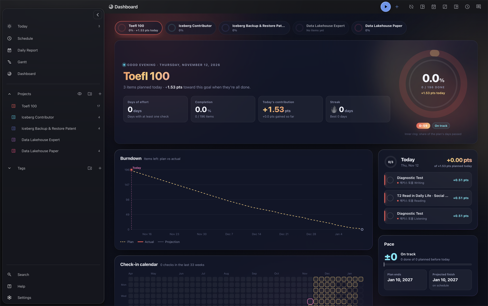
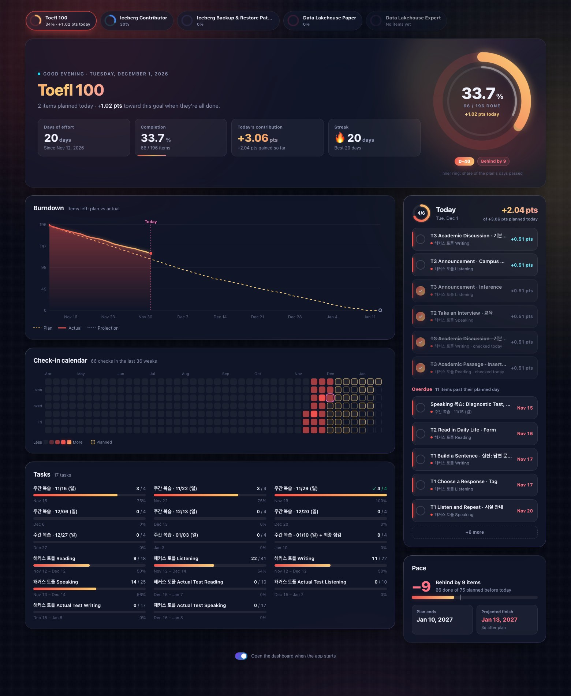
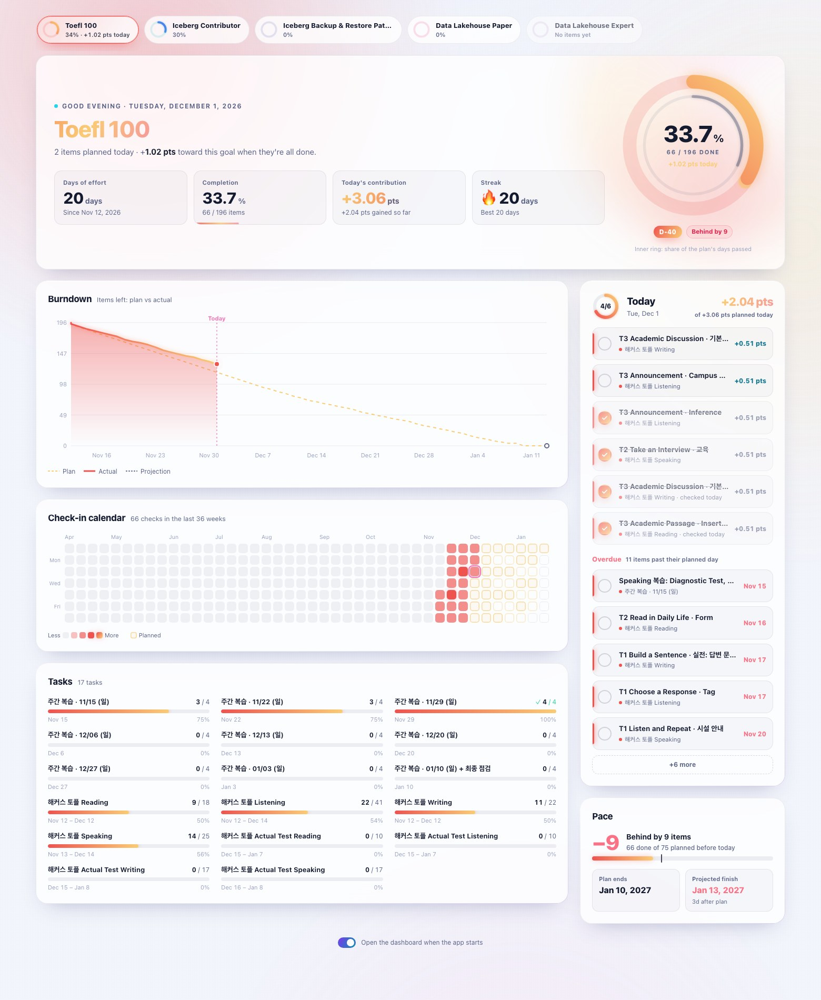

# Dashboard for Super Productivity

A [Super Productivity](https://super-productivity.com) plugin (v20+) that adds a goal progress dashboard
and makes it your home screen. Treat each project as a goal and look at one goal at a time: how far along it is,
how many days you've worked on it, what today's planned items add, and whether you're ahead of or behind plan.
It uses completion dates only, so you don't need time tracking.

Repository: https://github.com/riverandeye/super-productivity-dashboard

The UI follows the app language (English and Korean included; other languages fall back to English) and the
app's light/dark theme.



<details>
<summary>More screenshots</summary>

In the app, opened at startup instead of Today (no checks yet):



English, dark (demo data):



English, light (demo data):



</details>

## Install

1. Get the ZIP: [`release/goal-dashboard-1.1.0.zip`](https://github.com/riverandeye/super-productivity-dashboard/raw/main/release/goal-dashboard-1.1.0.zip)
   (or build it with `npm run build`; only Node and the system `zip` command are needed).
2. In the app, open **Settings → Plugins → Install Plugin** (Choose Plugin File) and pick the ZIP.
3. Confirm the install warning, then **turn the plugin on** with its switch in the plugin list (uploaded plugins
   start disabled). Uploading a ZIP with the same id (`goal-dashboard`) replaces the plugin.

Open the dashboard from:

- the **Dashboard** entry in the side menu,
- the dashboard button in the header (`space_dashboard` icon), and a button on the Today page header,
- the "Open goal dashboard" shortcut (assign keys in Settings → Keyboard Shortcuts),
- app start: see [Home screen](#home-screen).

## What it shows

Each project is a goal. The Inbox and archived projects are left out.

**One project at a time.** Pick a project in the strip at the top (each shows its progress ring, % and today's
points). Everything below is about that project only; nothing is summed across projects. The page accents
take the project's color. The first project in the side menu is shown by default; your pick lasts until the
app restarts. (The menu order isn't in the plugin API, so the dashboard reads it from the side menu; if it
can't, it uses the order of `getAllProjects()`.)

A **leaf** is a subtask, or a top-level task without subtasks. Completion counts leaves, so a book with 20 chapter
subtasks counts as 20 items, not 1. A leaf whose parent task is marked done counts as done.

| Metric | How it's calculated |
| --- | --- |
| **Days of effort** | Number of distinct days on which at least one task or subtask of the project was checked done (`doneOn`, local day, following the app's "start of next day" setting). Archived tasks count. |
| **Completion %** | Done leaves / all leaves. |
| **Today's contribution** | Percentage points the project gains if every leaf planned for today (`dueDay` or `dueWithTime` = today, not done) gets done: `planned today / all leaves × 100`. "Gained" is the same for leaves checked today. |
| **Pace vs plan** | For leaves with a planned day: done leaves − leaves planned *before* today. Positive means ahead by N items, negative means behind. Today's own items don't count against you until tomorrow. |
| **Projected finish** | The last planned day, moved by the pace at the plan's average rate (planned items per day). After the last planned day has passed, it uses the actual rate of checks since the start. |
| **D-day** | Days until the last planned day of the project. |
| **Streak** | Consecutive days with at least one check in the project. Today keeps the streak alive until it ends. |

Sections, all for the selected project:

- **Header**: the project name, today's summary, four KPI tiles and a big progress ring. The pulsing part of the
  ring is what today's planned items would add; the thin inner ring shows how much of the plan's time has passed.
  D-day and pace badges sit under the ring.
- **Burndown**: items left per day, plan (dashed) vs actual (area), a projection to the projected finish, and a
  today line. Hover for daily numbers.
- **Check-in calendar**: GitHub-style heatmap of checks per day. Future days are outlined by how many items are
  planned for them.
- **Tasks**: progress bar per top-level task (e.g. per book), in the project's order, with its planned date range.
  Click a title to open the task.
- **Today**: today's planned leaves with their parent task, and items checked today. Check them off right there
  (`PluginAPI.updateTask(id, { isDone: true })`); clicking a checked item again unchecks it. Click a title to open
  the task details. Overdue items (planned day passed, not done) are listed below.
- **Pace**: ahead/behind, a bar (fill = done, tick = where the plan expects you today), plan end and projected finish.

Everything updates live when tasks change (`dataChanged`), at day change (`dayChange`) and on language change.

## Home screen

Super Productivity's **Settings → Misc → Default start page** only offers Today, Planner, Schedule, Boards and
projects; it can't point at a plugin view. So the plugin does the next best thing: when the app starts on its
start page (Today), it switches to the dashboard right away.

- It happens once per app start. Re-enabling or updating the plugin doesn't move you.
- If you set a different default start page (a project, Schedule, …), the plugin leaves it alone.
- Turn it off with the **"Open the dashboard when the app starts"** switch at the bottom of the dashboard
  (saved with the plugin's synced data).

**Today stays in the side menu.** The app always shows the Today entry and has no setting or plugin API to hide it
(the "hide from menu" option exists for projects only, which is how the Inbox can be hidden). The plugin doesn't
patch the app's UI to get around that.

## Limitations

- **`doneOn` keeps only the last check.** Unchecking and re-checking replaces the date; checking many items at once
  records them all on that day.
- Pace, projected finish, burndown and D-day need planned days on items. Goals without them show completion and
  days of effort only.
- Subtask deadlines are not used, only planned days.
- The header button and shortcut labels are set when the plugin loads; after changing the app language they update
  on the next app start (the dashboard itself switches immediately).

## Development

```
src/
  manifest.json   id: goal-dashboard
  plugin.js       header button, shortcut, Today-page button, open on startup
  index.html      dashboard UI (iframe); no external resources
  lib.js          data model, inlined into index.html at build time
  i18n/*.json     UI strings; also inlined into index.html
  icon.svg
scripts/build.mjs builds dist/ and release/<id>-<version>.zip
test/             node --test unit tests for lib.js
```

```bash
npm test
```

```bash
npm run build
```

To add a language, add `src/i18n/<code>.json` with every key from `en.json` and list the code under
`i18n.languages` in `src/manifest.json`.

## License

MIT
